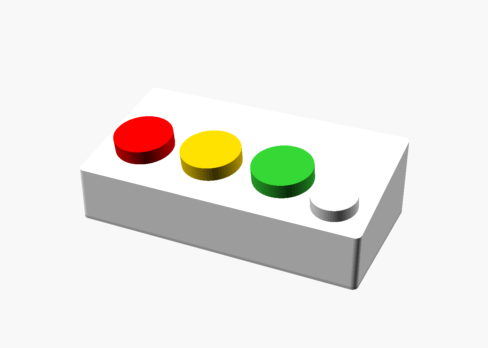
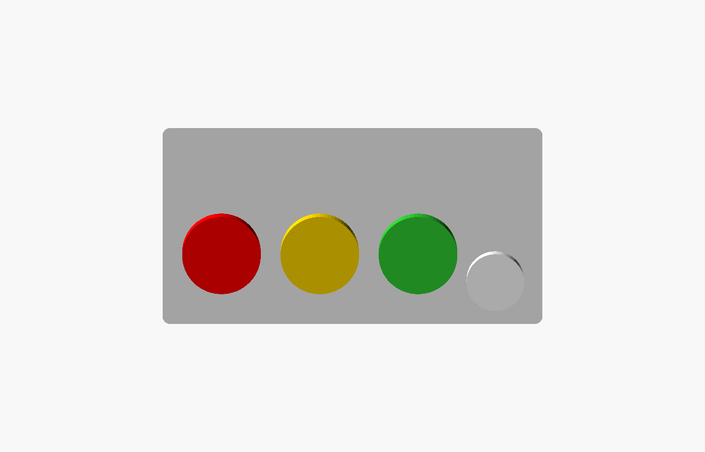
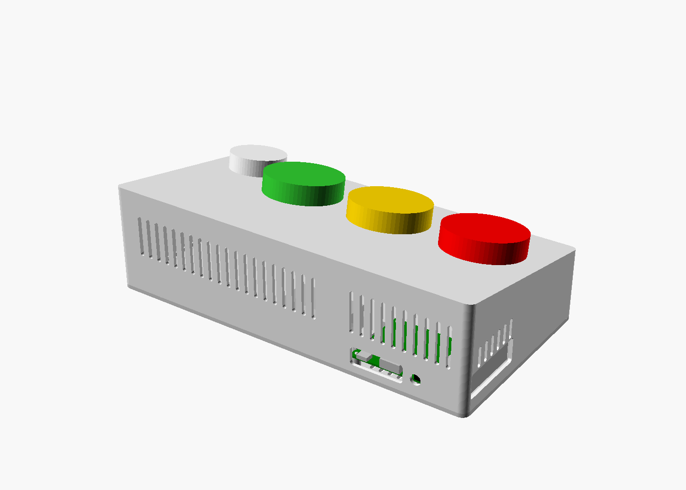
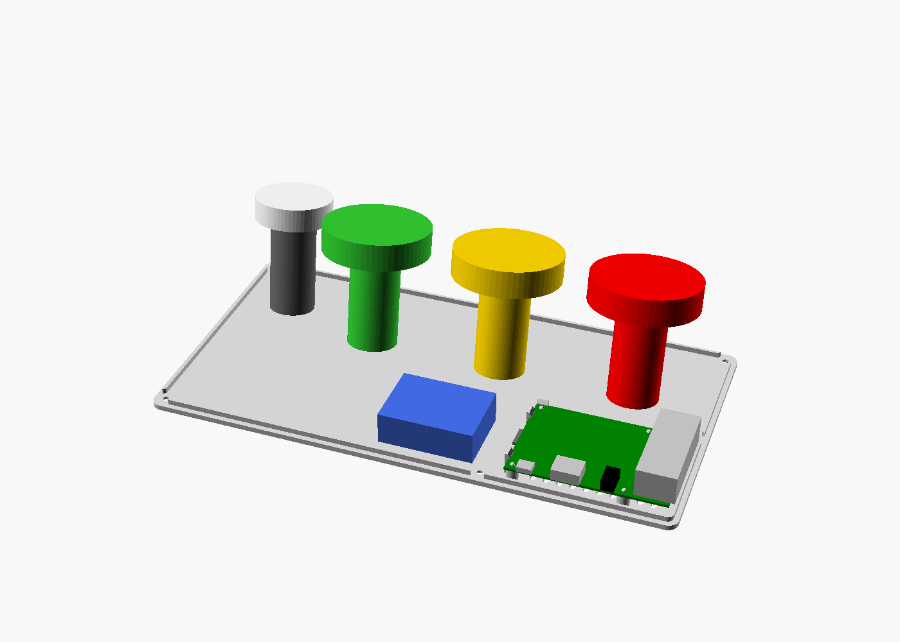
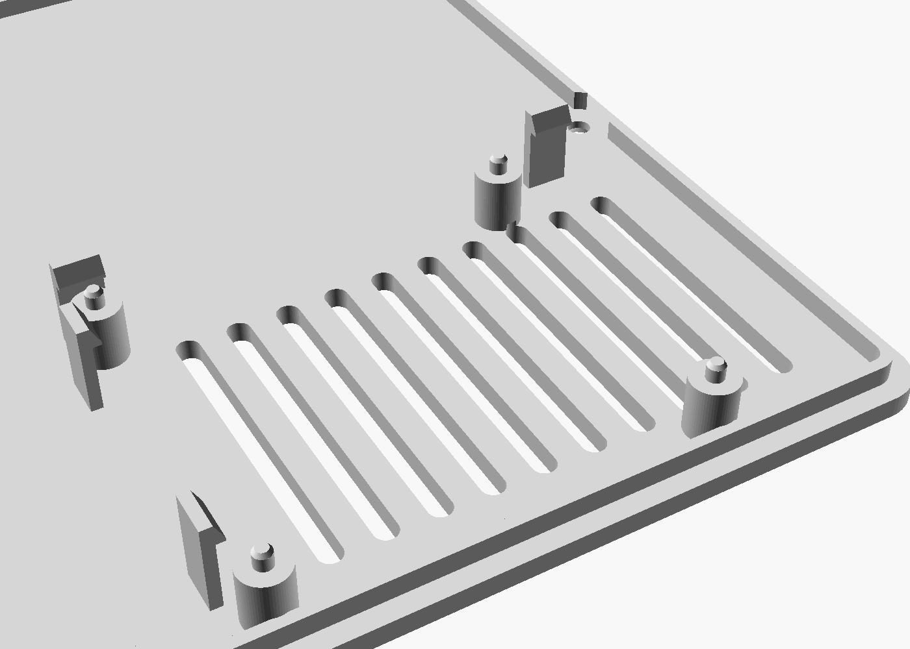
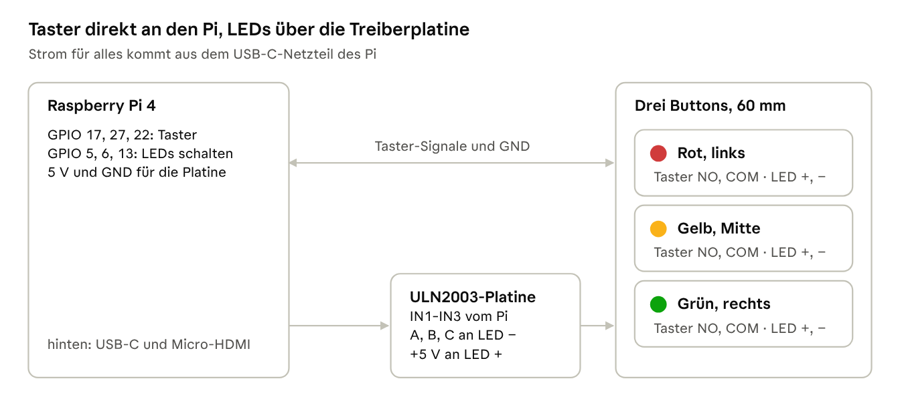
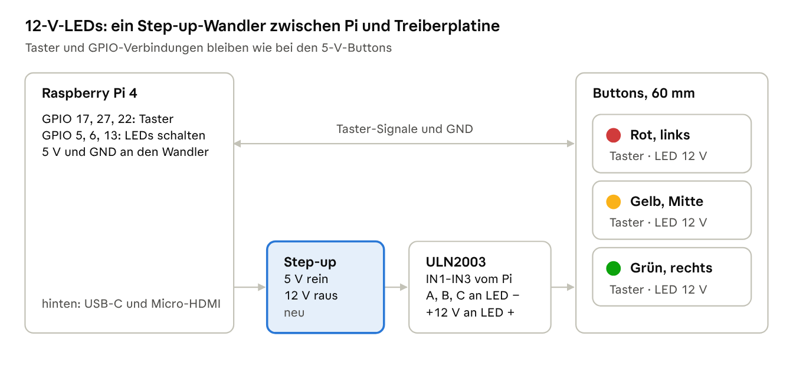

# Buzzer-Pult – Bauanleitung

Stand: 26.11.2026

## Überblick

Das Buzzer-Pult ist ein 3D-gedrucktes Gehäuse von 290 × 150 mm. Darin sitzen ein Raspberry Pi 3 (Modell B oder B+), drei beleuchtete 60-mm-Buttons (Bohrung 24 mm) in Rot, Gelb und Grün in einer Reihe und rechts daneben ein weisser 44-mm-Weiter-Button, etwas zum Benutzer hin versetzt. Mit ihm überspringt man eine Frage. Die Bedienfläche ist leicht geneigt: vorn 55 mm hoch, hinten 82 mm. So passt das Pult vor den Monitor, ohne den Bildschirm zu verdecken.

- **Strom und Bild:** Der Micro-USB-Stromanschluss und die HDMI-Buchse des Pi zeigen durch ein Fenster in der Rückwand nach hinten. Dort stecken Sie Netzteil und Monitorkabel ein.
- **Stromversorgung:** Alles läuft über das Netzteil des Pi. Die LEDs der Buttons bekommen 5 V vom Pi und werden über eine kleine Treiberplatine (ULN2003) geschaltet. Ein zweites Netzteil ist nicht nötig. Für Buttons mit 12-V-LEDs siehe [Variante 12 V](#variante-buttons-mit-12-v-leds).
- **Rückmeldung:** Im Ruhezustand pulsieren die Buttons abwechselnd, als Welle von Rot über Gelb nach Grün. Ein Durchlauf dauert 3 Sekunden. Nach einem Druck blinkt der gedrückte Button hell, die anderen gehen aus. Nach knapp 3 Sekunden ist das Pult wieder bereit, passend zur Sperrzeit der Web-App.
- **Weiter-Button:** kleiner und abgesetzt, damit ihn niemand mit einer Antwort verwechselt. Er leuchtet ruhig und blitzt beim Drücken kurz auf. Er zählt nicht als Stimme.
- **Ohne Schrauben:** Der Pi wird auf vier Stifte gesetzt und nach unten gedrückt, bis vier Haken über dem Platinenrand einrasten. Beim Aufsetzen des Oberteils legt sich hinten eine kleine Nase über die Platine, damit sie beim Einstecken der Kabel nicht abhebt.
- **Service:** USB- und LAN-Buchsen sind über ein Fenster in der linken Seitenwand erreichbar, etwa für Tastatur und Maus bei der Einrichtung. Die Bodenplatte lässt sich abschrauben, darunter liegt die SD-Karte.
- **Dateien:** Druckdateien und OpenSCAD-Quelle in [`../hardware/`](../hardware/), Software für den Pi in [`../raspi/`](../raspi/).

## Stückliste

Entscheidend bei den Buttons: Die eingebaute LED muss mit 5 V leuchten. Modelle mit eingebautem Vorwiderstand für 5–12 V sind ideal. Reine 12-V-LEDs, etwa beim BerryBase AB60L12, leuchten an 5 V nur schwach oder gar nicht; dafür gibt es die [12-V-Variante](#variante-buttons-mit-12-v-leds).

| Teil | Menge | Hinweis | Bezugsquelle |
| --- | --- | --- | --- |
| Raspberry Pi 3 Modell B oder B+ mit offiziellem Micro-USB-Netzteil (5,1 V, 2,5 A) | 1 | vorhanden | – |
| microSD-Karte, ab 16 GB | 1 | vorhanden | – |
| Kühlkörper für Pi 3 | 1 | empfohlen, da das Gehäuse geschlossen ist | Elektronikhandel |
| Arcade-Button 60 mm, Bohrung 24 mm, beleuchtet, rot / gelb / grün | je 1 | LED 5–12 V mit Vorwiderstand | [Purecrea bei digitec](https://www.digitec.ch/en/s1/product/purecrea-arcade-button-illuminated-60mm-red-buttons-switches-36688812) oder [Adafruit 60 mm](https://www.adafruit.com/product/1194) |
| Arcade-Button 44 mm, Bohrung 24 mm, beleuchtet, weiss | 1 | Weiter-Button; LED wie bei den grossen Buttons | Elektronikhandel |
| ULN2003-Treiberplatine („Schrittmotor-Treiber“, 4 Kanäle) | 1 | schaltet die vier LEDs (alle 4 Kanäle belegt) | Elektronikhandel, Amazon |
| Dupont-Kabel Buchse–Buchse, ca. 20 cm | ca. 20 | für GPIO und Treiberplatine | Elektronikhandel |
| Flachsteckhülsen passend zu den Button-Kontakten | ca. 16 | Taster meist 4,8 mm, LED je nach Modell; alternativ löten | Elektronikhandel |
| Kunststoffschraube 3 × 10 mm, Senkkopf | 5 | Boden an Oberteil | Baumarkt |
| Gummifüße Ø 12 mm, selbstklebend | 5 | rutschfest vor dem Monitor | Baumarkt |
| HDMI-Kabel | 1 | zum Monitor | Elektronikhandel |
| Filament PETG (oder PLA) | ca. 400 g | PETG hält Wärme besser aus | – |

Der Ton kommt über HDMI aus den Lautsprechern des Monitors. Hat der Monitor keine, kommt ein Aktivlautsprecher an die Klinkenbuchse auf der Rückseite oder ein kleiner USB-Lautsprecher an die linke Seite.

## Gehäuse drucken

Drucken Sie zuerst den Lochtest. Erst wenn die Buttons passen, drucken Sie das Gehäuse: Das Oberteil braucht ein Druckbett von mindestens 290 × 162 mm.

| Datei | Lage auf dem Druckbett | Grösse |
| --- | --- | --- |
| `hardware/Buzzerpult_Lochtest.stl` | flach | 186 × 46 × 3 mm |
| `hardware/Buzzerpult_Oberteil.stl` | Pultfläche nach unten, schon so ausgerichtet | 290 × 162 × 78 mm |
| `hardware/Buzzerpult_Boden.stl` | flach, Pi-Halterung nach oben | 290 × 150 × 15 mm |

1. **Lochtest:** Die Bohrung der Buttons ist 24 mm. Gedruckte Löcher fallen meist etwas kleiner aus, deshalb hat die Testplatte Löcher mit 23,8 / 24,0 / 24,3 / 24,6 / 25,0 mm. Schrauben Sie einen Button mit seiner Mutter in das passende Loch. Das Gewinde soll frei durchgehen, ohne zu wackeln. Im Gehäuse ist 24,3 mm eingestellt (24 mm plus 0,3 mm Zugabe). Passt ein anderes Loch besser, in `hardware/buzzerpult.scad` den Wert `hole_clr` (Zugabe) ändern und neu exportieren (siehe [hardware/README.md](../hardware/README.md)).
2. **Material:** PETG ist wärmefester und zäher als PLA. Für die Bodenplatte mit den federnden Haken ist PETG klar besser, PLA kann beim Einrasten brechen. Das Oberteil geht auch in PLA.
3. **Einstellungen:** 0,2 mm Schichthöhe, 3 Wandlinien, 15–20 % Füllung.
4. **Stützen:** Nicht nötig. Die beiden Anschlussfenster werden als Brücken von etwa 41 und 55 mm gedruckt, das schaffen die meisten Drucker. Wer unsicher ist, aktiviert Stützen nur ab Druckbett.
5. **Druckbett zu klein:** Online-Druckdienste drucken die STL-Dateien auf Bestellung, auch in PETG.

## Verdrahtung

Die Taster gehen direkt an den Pi, die LEDs über die ULN2003-Platine. Alles wird nur gesteckt. Die Pin-Nummern sind die physischen Nummern der 40-poligen Leiste: Pin 1 ist der Pin an der Ecke näher zur SD-Karte, die ungeraden Nummern liegen auf der Innenreihe.

Das Schaltbild zeigt die drei Farbbuttons. Der weisse Weiter-Button wird genauso angeschlossen: Taster an GPIO 23, LED über Kanal 4 der Treiberplatine (siehe Tabelle).

| Von | Nach | Pi-Pin | GPIO |
| --- | --- | --- | --- |
| Taster rot, Kontakt NO | Pi | 11 | GPIO 17 |
| Taster gelb, Kontakt NO | Pi | 13 | GPIO 27 |
| Taster grün, Kontakt NO | Pi | 15 | GPIO 22 |
| Taster weiss (Weiter), Kontakt NO | Pi | 16 | GPIO 23 |
| alle vier Taster, Kontakt COM | Pi, Masse | 9, 14 oder 20 | GND |
| ULN2003 IN1 | Pi | 29 | GPIO 5 |
| ULN2003 IN2 | Pi | 31 | GPIO 6 |
| ULN2003 IN3 | Pi | 33 | GPIO 13 |
| ULN2003 IN4 | Pi | 35 | GPIO 19 |
| ULN2003 Stromanschluss + | Pi, 5 V | 2 | – |
| ULN2003 Stromanschluss − | Pi, Masse | 6 | GND |
| LED rot / gelb / grün / weiss, Kontakt + | ULN2003, fünfter Pin des Motorsteckers (+5 V) | – | – |
| LED rot, Kontakt − | ULN2003, Ausgang A | – | – |
| LED gelb, Kontakt − | ULN2003, Ausgang B | – | – |
| LED grün, Kontakt − | ULN2003, Ausgang C | – | – |
| LED weiss, Kontakt − | ULN2003, Ausgang D | – | – |

- **Mikroschalter:** Er hat drei Kontakte: COM, NO und NC. Nur COM und NO werden verwendet. Wer NC erwischt, bekommt einen Button, der dauernd als „gedrückt“ gilt.
- **Masse:** Die vier COM-Kontakte können Sie mit einem kurzen Kabel verbinden und gemeinsam auf einen GND-Pin führen.
- **LED-Polung:** Die Kontakte sind meist mit + und − markiert. Leuchtet eine LED im Test nicht, Kabel tauschen.
- **Jumper:** Viele ULN2003-Platinen haben einen Jumper für die Versorgung. Er muss gesteckt sein.
- **Strombedarf:** Die vier LEDs brauchen zusammen deutlich unter 100 mA. Das offizielle 2,5-A-Netzteil des Pi 3 reicht problemlos.

## Variante: Buttons mit 12-V-LEDs

Auch Buttons mit reinen 12-V-LEDs laufen am Netzteil des Pi. Ein kleiner Aufwärtswandler („Step-up“) macht aus den 5 V des Pi die 12 V für die LEDs. Software, Gehäuse und Taster-Verdrahtung bleiben gleich.

**Zusätzliche Teile**

| Teil | Menge | Hinweis |
| --- | --- | --- |
| Aufwärtswandler 5 V → 12 V, z. B. Modul MT3608 | 1 | Modul mit fest eingestellten 12 V erspart das Einstellen |
| Multimeter | 1 | nur für einstellbare Module wie das MT3608 |
| Arcade-Buttons 60 mm mit 12-V-LED | 3 | ersetzen die 5-V-Buttons, z. B. BerryBase AB60L12 |
| Weiter-Button 44 mm mit 12-V-LED | 1 | alle vier Buttons müssen dieselbe LED-Spannung haben |

**Geänderte Verbindungen** (alles andere wie in der Tabelle oben)

| Von | Nach |
| --- | --- |
| Pi Pin 2 (5 V) | Wandler IN+ |
| Pi Pin 6 (GND) | Wandler IN− |
| Wandler OUT+ (12 V) | ULN2003 Stromanschluss + |
| Wandler OUT− | ULN2003 Stromanschluss − |
| LED + aller vier Buttons | ULN2003, fünfter Pin des Motorsteckers (jetzt +12 V) |

1. **Spannung zuerst einstellen:** Beim MT3608 den Wandler allein an den Pi hängen, Pi einschalten und am Ausgang mit dem Multimeter messen. Das kleine Potentiometer drehen, bis 12 V anliegen. Erst dann die ULN2003-Platine anschliessen.
2. **Die ganze Platine an 12 V:** Die ULN2003-Platine bekommt komplett 12 V, nicht nur die LEDs. Sonst fliesst Strom über ihre Schutzdioden zurück in die 5-V-Leitung des Pi, und die LEDs gehen nie ganz aus.
3. **12 V nie an die GPIO-Leiste:** Die Taster bleiben an 3,3-V-Pins und GND. Ein 12-V-Kabel an einem GPIO-Pin beschädigt den Pi.
4. **Einbau:** Den Wandler mit doppelseitigem Klebeband hinten rechts neben die ULN2003-Platine kleben, mit der Platine nach oben und ohne Kontakt zu anderen Teilen.

**Strom:** Vier 12-V-LEDs brauchen zusammen typischerweise 40–80 mA. Auf der 5-V-Seite sind das grob 130–230 mA, inklusive Verlust im Wandler. Das offizielle 2,5-A-Netzteil des Pi 3 reicht dafür gut.

## Zusammenbau

Der Pi sitzt hinten links, wenn Sie von vorn auf das Pult schauen. Testen Sie alles, bevor Sie das Gehäuse zuschrauben.

1. **Kühlkörper** auf die Chips des Pi kleben.
2. **Pi einklicken:** SD-Karte vorher einstecken. Den Pi so halten, dass Strom- und HDMI-Buchse zur hinteren Kante zeigen und die USB- und LAN-Buchsen zur linken. Die Montagelöcher über die vier Stifte setzen und die Platine gleichmässig nach unten drücken, bis die vier Haken hörbar einrasten. Zum Herausnehmen die beiden Haken an der GPIO-Seite mit dem Finger leicht nach aussen drücken und die Platine anheben.
3. **ULN2003-Platine** (und bei der 12-V-Variante den Wandler) mit doppelseitigem Klebeband hinten in der Mitte auf den Boden kleben, rechts neben dem Pi (Bereich etwa 52 × 38 mm, siehe Innenansicht). Dort ist sie vor den Schaltern aller vier Buttons sicher.
4. **Buttons einsetzen:** Mikroschalter und LED-Fassung abnehmen, den Button von oben durch das Loch stecken, die Mutter von innen festdrehen. Danach Fassung und Schalter wieder aufsetzen. Von vorn gesehen: rot links, gelb Mitte, grün rechts, der weisse Weiter-Button ganz rechts, etwas weiter vorne.
5. **Verdrahten** nach der Tabelle oben. Die Kabel zu den Buttons grosszügig lassen, damit Sie das Oberteil später abheben können.
6. **Testen**, solange das Gehäuse offen ist: Software installieren und den Testmodus starten (nächster Abschnitt). Jeder Farbbutton muss die richtige Ziffer melden und seine LED blinken lassen, der Weiter-Button meldet „Taste 4“.
7. **Schliessen:** Oberteil auf den Boden setzen. Ein Rand auf der Bodenplatte zentriert es. Dann von unten mit fünf Schrauben 3 × 10 befestigen und die Gummifüsse in die runden Vertiefungen kleben.
8. **Anschliessen:** Pult vor den Monitor stellen, auf der Rückseite das HDMI-Kabel zum Monitor und zuletzt das Micro-USB-Netzteil einstecken.

## Software auf dem Raspi

Ein kleiner Dienst (`raspi/buzzer.py`) liest die Buttons, „tippt“ die Tasten 1, 2 und 3 und steuert die LEDs. Der Browser startet beim Einschalten im Vollbild die Terminal-Seite der Web-App (`/terminal`). Ein Benutzerkonto braucht das Gerät nicht: Es wird mit einem Code gekoppelt.

1. **Betriebssystem:** Mit dem Raspberry Pi Imager „Raspberry Pi OS (64-bit)“ mit Desktop auf die SD-Karte schreiben (Gerät: Raspberry Pi 3). Im Imager gleich WLAN, Benutzer und Passwort eintragen. Der Pi 3 hat 1 GB Arbeitsspeicher: Für die eine Terminal-Seite reicht das, weitere Programme sollten nicht laufen.
2. **Dateien kopieren:** den Ordner `raspi/` aus dem Repository auf den Pi legen, zum Beispiel per USB-Stick oder `git clone`.
3. **Installieren:** Im Terminal in diesen Ordner wechseln und `bash install.sh` ausführen. Das Skript installiert die Pakete, richtet den Buzzer-Dienst ein, trägt den Browser-Autostart ein und schaltet den Bildschirmschoner aus. Andere Adresse der App: `APP_URL=https://… bash install.sh`.
4. **Neu starten** mit `sudo reboot`. Der Bildschirm zeigt einen 6-stelligen Kopplungscode.
5. **Koppeln:** In der Web-App unter **Terminals → Terminal koppeln** den Code und den Standort eingeben. Das Terminal zeigt danach sofort die aktive Frage.
6. **Testmodus:** `sudo systemctl stop buzzer`, dann `sudo python3 /opt/stimmungsbarometer/buzzer.py --test`. Jeder Druck wird im Terminal angezeigt. Mit Strg+C beenden und `sudo systemctl start buzzer` eingeben.

**Damit die Tasten ankommen:** Der Browser leitet Tastendrücke nur an die Seite weiter, wenn sie den Fokus hat. Der Dienst klickt deshalb 30 Sekunden nach dem Start und danach alle 10 Minuten in einer Ruhephase einmal in die Bildschirmmitte. Danach schiebt er den Mauszeiger in die Ecke. Im Terminal-Bildschirm ist der Mauszeiger zusätzlich ausgeblendet.

**Service-Menü am Terminal:** Linke obere Ecke 3 Sekunden gedrückt halten (Maus oder Touch). Dort gibt es Vollbild, Ton an/aus, Neu laden und Entkoppeln.

**Einstellungen** stehen oben in `buzzer.py`:

| Wert | Standard | Bedeutung |
| --- | --- | --- |
| `IDLE_MODE` | `"wave"` | Ruhezustand: `"wave"` abwechselnd pulsierend, `"dim"` gedimmt, `"pulse"` alle gleichzeitig pulsierend, `"on"` voll |
| `WAVE_PERIOD_S` | `3.0` | Dauer eines Durchlaufs über alle drei Buttons in Sekunden |
| `WAVE_MIN` | `0.04` | Grundglimmen zwischen den Pulsen (0 = ganz dunkel) |
| `IDLE_LEVEL` | `0.35` | Helligkeit im Modus `"dim"` |
| `LOCK_S` | `2.8` | Sperrzeit nach einem Druck in Sekunden (gleich wie in der Web-App) |
| `FOCUS_EVERY_S` | `600` | Abstand der Fokus-Klicks in Sekunden |
| `NEXT_PIN` | `23` | GPIO des Weiter-Buttons; `None`, wenn keiner eingebaut ist |
| `NEXT_LEVEL` | `0.5` | Helligkeit des Weiter-Buttons im Ruhezustand |

Nach einer Änderung die Datei nach `/opt/stimmungsbarometer/` kopieren und `sudo systemctl restart buzzer` ausführen.

## Fehlersuche und Anpassungen

| Problem | Wahrscheinliche Ursache | Lösung |
| --- | --- | --- |
| Ein Button meldet sich dauernd oder nie | Kabel an NC statt NO | Kabel vom NC- auf den NO-Kontakt umstecken |
| LED leuchtet nicht | Polung vertauscht, Jumper fehlt oder LED nur für 12 V | Kabel an der LED tauschen, Jumper auf der ULN2003-Platine stecken, bei 12-V-LEDs die Variante mit Step-up-Wandler bauen |
| Testmodus zeigt Drücke, der Browser reagiert nicht | Seite hat keinen Fokus | Einmal auf den Bildschirm klicken oder den Fokus-Klick abwarten |
| Terminal zeigt wieder einen Kopplungscode | in der Web-App entkoppelt | Code in der Web-App neu eingeben |
| Weiter-Button: Testmodus zeigt „Taste 4“, am Bildschirm passiert nichts | Web-App kennt „Weiter“ noch nicht | wird in der Web-App ergänzt (siehe Konzept, „Weiter-Button“) |
| Oben rechts „offline“ | keine Internetverbindung | Antworten werden im Gerät gepuffert und nachgesendet, sobald die Verbindung zurück ist |
| Kein Ton | Tonausgabe nicht auf HDMI oder Monitor stumm | Im Desktop oben rechts über das Lautsprechersymbol HDMI wählen, Lautstärke am Monitor prüfen |
| Pi wird sehr warm | Gehäuse geschlossen, keine Kühlkörper | Kühlkörper aufkleben, Lüftungsschlitze freihalten. `vcgencmd measure_temp` zeigt die Temperatur, ab 80 °C drosselt der Pi |
| Button-Gewinde passt nicht ins Loch | Drucker druckt Löcher enger oder weiter | Lochtest prüfen, `hole_clr` in `buzzerpult.scad` anpassen |
| Haken rasten nicht ein oder brechen | Material zu spröde oder Platine schräg aufgesetzt | Bodenplatte in PETG drucken; Platine erst auf alle vier Stifte setzen, dann gleichmässig drücken. Bei Bedarf `clip_t` (Stegstärke) in `buzzerpult.scad` verringern |
| Oberteil zu gross für den Drucker | Druckbett unter 290 × 162 mm | Online-Druckdienst nutzen |
